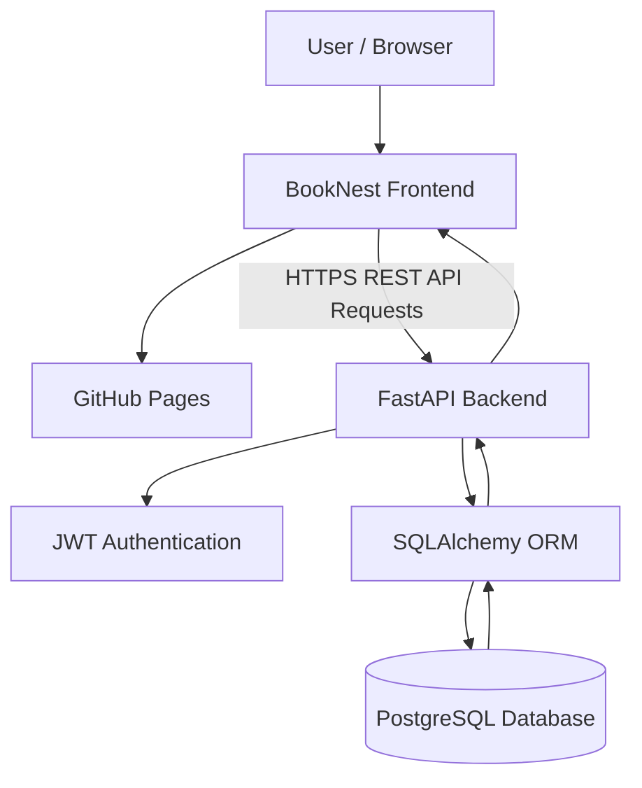

# BookNest — Full-Stack Book Discovery Platform

BookNest is a full-stack book discovery and personal library web application. Users can explore books, search by title, filter by category, preview book details, and maintain their own personal reading library.

**Live Website:** https://ananya507.github.io/BookNest-/

**Backend API:** https://booknest-backend-h49h.onrender.com/

**API Documentation:** https://booknest-backend-h49h.onrender.com/docs

## Features

- **Book Discovery:** Browse a collection of books across different categories.
- **Search and Filtering:** Find books by title and filter them by category.
- **Book Preview:** View book information before opening its reading link.
- **User Authentication:** Register and log in using JWT-based authentication.
- **Personal Library:** Save books and remove them from your personal collection.
- **Persistent Storage:** Saved books and user information are stored in PostgreSQL.
- **Responsive Interface:** Editorial-inspired design with an ivory, forest-green and gold color palette.

## Tech Stack

| Layer | Technologies |
|---|---|
| Frontend | HTML, CSS, JavaScript |
| Backend | Python, FastAPI |
| Database | PostgreSQL, SQLAlchemy |
| Authentication | JWT, Passlib, bcrypt |
| API Communication | REST API, Fetch API |
| Frontend Hosting | GitHub Pages |
| Backend Hosting | Render |

## Architecture



## Application Workflow

1. Users access the frontend hosted on GitHub Pages.
2. The frontend communicates with the FastAPI backend through REST API requests.
3. Users register or log in, and the backend issues a JWT access token.
4. Authenticated requests include the token in the Authorization header.
5. Users can save or remove books from their personal library.
6. The backend stores and retrieves library information from PostgreSQL.

## API Endpoints

| Method | Endpoint | Purpose |
|---|---|---|
| GET | `/books` | Retrieve all books |
| GET | `/books/{book_id}` | Retrieve a specific book |
| POST | `/books/bulk` | Add multiple books |
| POST | `/register` | Register a user |
| POST | `/login` | Authenticate a user |
| GET | `/me` | Retrieve authenticated user details |
| POST | `/my-library/{book_id}` | Save a book |
| GET | `/my-library` | Retrieve saved books |
| DELETE | `/my-library/{book_id}` | Remove a saved book |

## Project Structure

```text
BookNest/
│
├── index.html
├── style.css
├── script.js
├── auth.html
├── auth.css
├── auth.js
├── auth-nav.js
├── my-library.html
├── my-library.js
│
├── book1.png
├── book2.png
├── ...
│
└── backend/
    ├── main.py
    ├── models.py
    ├── database.py
    ├── requirements.txt
    └── .gitignore
```

## Running Locally

### 1. Clone the repositories

Frontend:

```bash
git clone https://github.com/Ananya507/BookNest-.git
```

Backend:

```bash
git clone https://github.com/Ananya507/BookNest-Backend.git
```

### 2. Set up the backend

```bash
cd BookNest-Backend
python -m venv venv
```

Activate the virtual environment on Windows:

```powershell
.\venv\Scripts\Activate.ps1
```

Install dependencies:

```bash
pip install -r requirements.txt
```

Configure the required environment variables:

- `SECRET_KEY`
- `DATABASE_URL` (SQLite can be used locally; PostgreSQL can be configured separately).

### 3. Start the backend

```bash
uvicorn main:app --reload
```

The API will be available at:

`http://127.0.0.1:8000`

### 4. Run the frontend

Open the frontend folder in VS Code and launch `index.html` using a local development server such as Live Server.

For local development, configure the frontend API URL to point to:

`http://127.0.0.1:8000`

For production, the frontend uses the deployed Render API.

## Deployment

- Frontend: GitHub Pages
- Backend: Render
- Database: PostgreSQL hosted on Render

## Learning Outcomes

Building BookNest involved practical experience with:

- Designing a multi-page frontend.
- Connecting JavaScript applications to REST APIs.
- Developing backend endpoints using FastAPI.
- Implementing JWT authentication.
- Working with relational databases and SQLAlchemy.
- Integrating persistent user-specific data.
- Deploying a full-stack application.

---

**Author:** Ananya Majumdar

**Frontend Repository:** https://github.com/Ananya507/BookNest-

**Backend Repository:** https://github.com/Ananya507/BookNest-Backend
